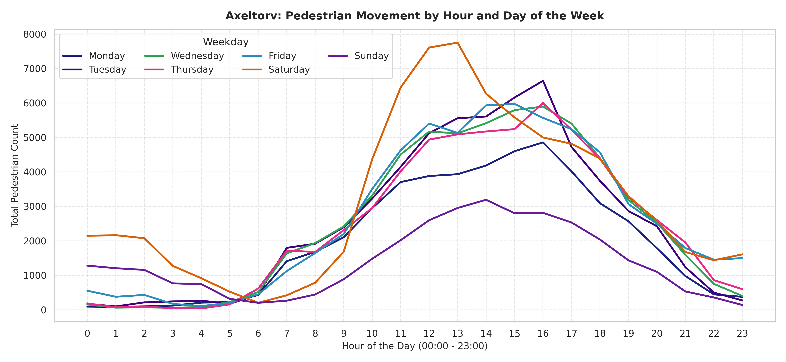
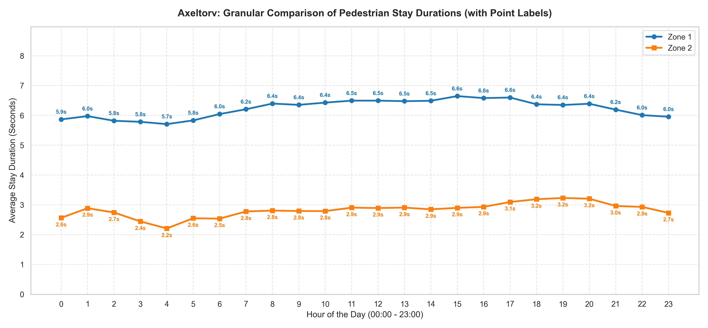
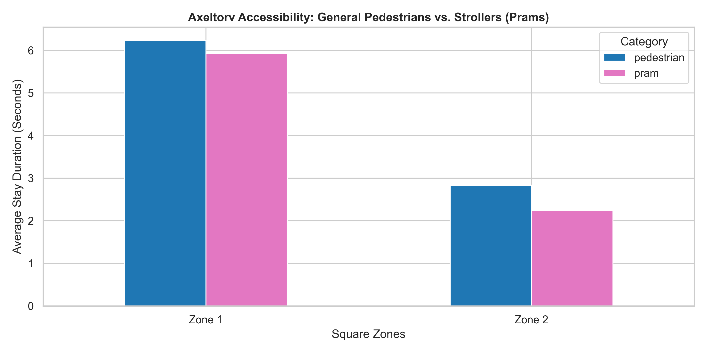
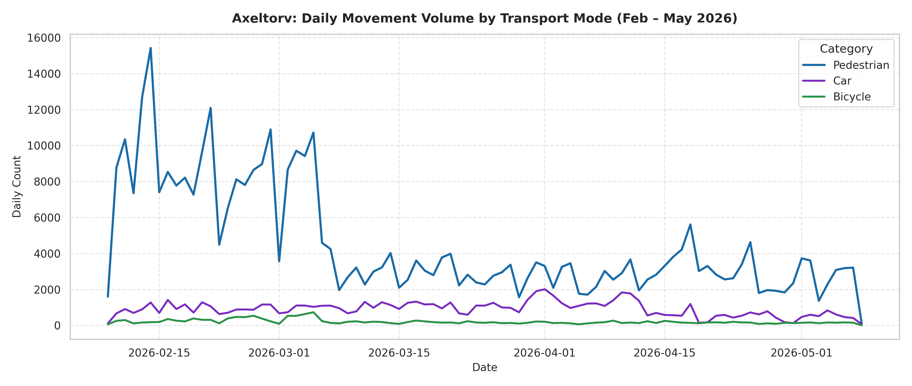

# Kolding Hackathon 2026: Is Axeltorv a Destination or a Transit Pipeline?

Urban mobility and demographic segmentation analysis developed for the **Kolding Hackathon 2026**, examining municipal population cohorts and hourly IoT sensor foot-traffic / dwell-time patterns around **Axeltorv** (Kolding city center, Denmark).

> **Team & Contribution:** Developed as a collaborative group project for the Kolding Hackathon 2026. My individual contributions focused on municipal demographic cohort segmentation (`pop.Rmd`), hourly IoT sensor dwell-time and movement analysis (`stay_duration.py`), data visualization, and translating findings into activation recommendations.

## Key Visual Findings

### 1. Pedestrian Movement by Hour & Day of the Week

- Peak pedestrian movement occurs on **Saturdays at 13:00**, with highest daily activity between **10:00 and 16:00**.
- Friday and Saturday nights show elevated late-night activity between **00:00 and 02:00**, while **Sunday** has the lowest foot traffic.

### 2. Hourly Pedestrian Stay Duration by Zone (`Zone 1` vs. `Zone 2`)

- Average pedestrian stay durations remain between **5.7s–6.6s in Zone 1** and **2.2s–3.2s in Zone 2**, demonstrating that Axeltorv currently functions primarily as a **transit pipeline** rather than a lingering destination.

### 3. Family & Stroller Accessibility Across Zones

- Visitors with strollers (`pram`) move through both zones at nearly the same pace as general pedestrians (under 6 seconds in Zone 1 and under 3 seconds in Zone 2)—confirming that the square is physically accessible, yet lacks family-oriented amenities to encourage stopping.

### 4. Daily Movement Volume by Transport Mode

- Pedestrians dominate square activity compared to cars and bicycles, reinforcing the opportunity for pedestrian-first placemaking.

## Demographic & Strategic Recommendations
- **Municipal Target Segments (`pop.Rmd`):** Over 58% of Kolding citizens are over 35, while **16.08% are children (0–14)** and **25.92% are youth and young professionals (15–35)**.
- **Placemaking Interventions:** Introduce shaded green seating areas, water refill stations, public restrooms, and temporary weekend play hubs to convert pass-through foot traffic into longer stays.

## Repository Contents
- `stay_duration.py` — Python (`pandas`, `matplotlib`, `seaborn`) pipeline generating dwell-time, stroller accessibility, weekday movement, and daily modal split visualizations.
- `pop.Rmd` — R Markdown script cleaning and aggregating Kolding municipal population cohorts (`population.xlsx`).
- `population.xlsx` — Kolding municipal population dataset (`statbank.dk/FOLK1AM`).
- `pedestrian_movement_by_weekday.png`, `zone_comparison_labeled.png`, `family_accessibility_comparison.png`, `daily_movement_by_mode.png` — Exported analytical charts embedded above.

> *Note: Raw multi-megabyte hourly sensor logs (`stay_duration_stats_hourly.csv`, `movement_stats_hourly.csv`) are omitted from version control to keep the repository lightweight.*
